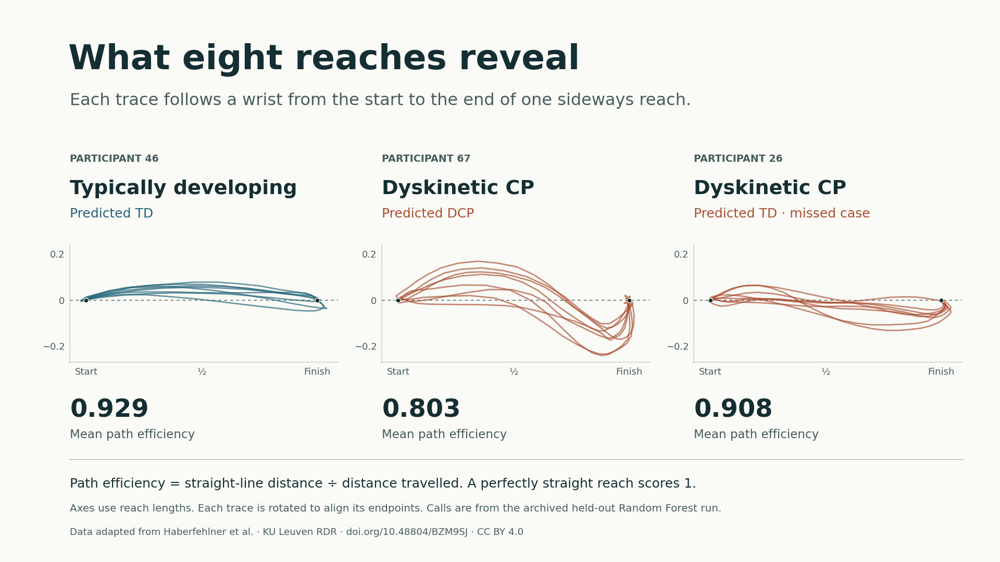

# Upper-limb reaching project review

This is the pre-implementation audit. For the completed demo, corrected benchmark and launch instructions, see the [presentation guide](README.md).

The project can reproduce a real movement-analysis experiment. Its 16-model benchmark runs on the supplied frame data, and its Random Forest correctly classified 46 of 51 held-out participants. The packaged layout breaks the default startup, the biomarker branch has a broken column reference, and the project still needs a user-facing demonstration. A compelling presentation would let someone see a reach, inspect what was measured, and discover where the classifier makes a mistake.

## What the system measures

The source study recorded eight sideways reaches per participant, from the upper leg toward a shoulder-height target. DeepLabCut had already extracted the 2D landmarks before this project's first step. The cohort contains 30 participants with dyskinetic cerebral palsy (DCP) and 21 typically developing (TD) peers, ages 5–24. There are 20,578 frames, 408 reaches and 51 independent participants. The study recorded at 25 Hz and estimated approximately 2 mm per pixel for its setup. A new camera needs its own distance calibration and timestamps. [Dataset and license](https://doi.org/10.48804/BZM9SJ) · [Study methods](https://www.medrxiv.org/content/10.1101/2023.08.09.23293642v1.full)

The scripts smooth each reach and calculate quantities such as wrist-path length, path efficiency, sideways deviation, speed, joint angles and smoothness. One branch combines repetitions into eight biomarker indices and a Functional Resilience Index. A second branch summarizes 28 measurements over eight reaches using the mean, variability, slope and other descriptors. This currently yields 162 usable predictors for one classification per participant. The benchmark fits its imputer, scaler and feature selector inside the training folds. A single reach can be measured immediately. The classifier was evaluated on eight-reach sessions. [Feature extraction](src/03_features.py) · [Biomarkers](src/04_biomarkers.py) · [Repetition descriptors](src/08_repetition_descriptors.py) · [Benchmark pipeline](src/23_model_benchmark.py)

## What I ran

I tested the two startup commands in the supplied layout and ran the remaining checks in temporary project copies. The audit environment used Python 3.11, NumPy 2.2.6, pandas 2.3.3, SciPy 1.15.3 and scikit-learn 1.6.1. All 25 scripts compiled. The system Python's NumPy 1.26.4 could not read the distributed pickles, and Step 03 uses the NumPy 2 function `trapezoid`.

| Steps | Execution and result |
|---|---|
| 01, load workbooks | Fails as packaged because `data/raw/` is absent. I downloaded KU Leuven's published archive, verified its checksum and ran the loader. The unedited archive yielded 407 accepted files with a successful exit. Normalizing one filename yielded 408 and reproduced the distributed raw frame table exactly, including metadata. |
| 02–03 and 07–09, preprocessing and repetition features | Step 02 fails as packaged because the source reads `data/processed/` and the deliverable has `processed/`. With the expected layout and the raw checkpoint, these five steps ran. The cleaned frames and all five regenerated CSVs matched the distributed tables within numerical tolerance, including missing values. |
| 04, subject biomarkers | Fails on a fresh Step 03 output. In an isolated test the verified column mapping reproduced all 53 numeric columns and the three metadata columns in the archived subject table. |
| 05–06, biomarker models and reports | Both executed using the archived biomarker table and generated model outputs, explanations and reports. Step 05 emitted numerical warnings during this run. Interpret the reports as retrospective examples. |
| 11, 12 and 23, feature stability, representation comparison and benchmark | Ran the original searches on the rebuilt experiment data. The full benchmark produced 816 held-out rows across 16 models. All 51 Random Forest class calls agreed with the archive. Six models' mean accuracies differed from their archived values. |
| 10, 16, 19 and 20, nested search and model explanations | Exercised every model and all five outer and four inner folds with one original hyperparameter configuration per model. The scripts produced predictions, feature importances and SHAP outputs. These four runs verify execution paths and leave the exhaustive searches unverified. |
| 13–15, 17–18, 21–22 and 24–25, analysis and reporting | Regenerated statistics, figures, bootstrap intervals, confusion and curve summaries, permutation importance, comparison tables and the audit with the supplied inputs. Steps 13, 14, 22 and 24 also ran from fresh upstream outputs. I decoded all 17 supplied PNGs and independently checked labels, participant coverage and fold membership in the saved predictions. |

## Repairs in priority order

| Priority | Finding | A concrete completion check |
|---|---|---|
| 1. Make startup reproducible | Introduce one data-root setting, a dependency lock, a dataset citation and one command to run from the supplied frames. Offer a separate raw rebuild from the public archive. Its file `60_left_TD_reo2.xlsx` corresponds to `60_left_TD_rep2.xlsx`. The loader currently logs and skips it. | A fresh checkout can generate the experiment table. Raw ingest explicitly maps the one known typo, retains its original name in a manifest, and fails on unexpected omissions or duplicate repetitions. Verify eight distinct repetitions for each of 51 participants. |
| 2. Repair the two feature contracts | Step 04 requests `stability_lateral_deviation_mm`. Step 03 emits `mean_lateral_deviation_mm`, which reproduced the archived biomarker values in the isolated test. Step 03 also counts flattened target coordinates and expects exactly two values across a whole reach. This makes `position_error_mm` empty for all 408 reaches and removes its six descriptors from the experiment. | Share a canonical name and test the Step 03 → 04 interface. Define the endpoint as the final valid paired wrist and target coordinates. In the supplied cleaned data, 400 reaches have both on the final frame and eight lack a target throughout. Track imputed endpoints separately. Rebuild downstream analyses when adding the restored feature. |
| 3. Give every result one identifiable model run | The archived nested-search feature manifest lists 168 predictors against today's 162. The SHAP and top-three Random Forest configurations differ in every saved fold. Several scripts independently refit their models with an unseeded mutual-information selector. The figure index also names two absent PNGs. | Save the feature schema, data hash, package versions, seed, train/test participant IDs, each fitted fold pipeline, predictions and explanations together. Generate the figure index after all charts. A displayed case score and its explanation must resolve to the same model and fold. |
| 4. Make scores suitable for display | Steps 05–06 fit a model on the whole biomarker table to produce individual reports. The CDS table scores all 51 training participants correctly. Step 04 also standardizes these biomarkers on the full cohort. Its resilience score and qualitative bands depend on that reference. | Use held-out predictions for study participants. Fit reference transforms on training participants and freeze them for new sessions. Label the index as a research summary. Clinical severity or progress claims would need independent clinical outcomes and repeat-session or external validation. |
| 5. Add an inference and device interface | The project reads labeled Excel exports. The filename parser even requires a known TD or DCP label. The workspace has no capture client, session service, dashboard or serialized inference pipeline for a new participant. | One unlabeled session accepts measurements, records its side and timestamps, counts valid reaches, computes features and exports a result using a frozen model. The complete demo can also play a bundled recording without network access. |

The implementation points for the first four repairs are in the loader, endpoint check, legacy feature list and report scoring branch. [Loader](src/01_load_raw.py) · [Endpoint calculation](src/03_features.py) · [Legacy input names](src/04_biomarkers.py) · [Report scoring](src/06_cds_report.py) · [Archived nested feature manifest](results/nested_cv/feature_columns.json) · [Saved SHAP configurations](results/shap_oof/shap_fold_summary.csv) · [Saved validation configurations](results/top3_validation/top3_best_parameters.csv)

## Numbers to present

These figures pool one held-out prediction per participant for each named Random Forest experiment. Each row uses the same 51 people. A majority-class baseline gets 30/51 correct (58.8%).

| Experiment | Correct | DCP detected | TD correctly classified | Pooled ROC AUC |
|---|---:|---:|---:|---:|
| Full 16-model benchmark, rerun during this review | **46/51 (90.2%)** | 26/30 | 20/21 | 0.970 |
| Archived top-three run, tuned for F1 | 48/51 (94.1%) | 27/30 | 21/21 | 0.951 |
| Archived broader nested search, older feature manifest | 47/51 (92.2%) | 27/30 | 20/21 | 0.973 |

Use the **46/51** result as the main slide. Its five errors were four missed DCP cases and one TD case classified as DCP. The often-quoted 0.978 is the benchmark's mean of five fold AUCs, while 0.970 is its AUC across all 51 held-out scores. The stored bootstrap intervals belong to the third row. A separate fixed-seed refit using the archived top-three winning settings agreed on 50 of the 51 archived class calls. [Benchmark predictions](results/model_benchmark/model_benchmark_predictions.csv) · [Top-three predictions](results/top3_validation/top3_predictions.csv) · [Nested predictions](results/nested_cv/nested_cv_predictions.csv) · [Bootstrap table](results/bootstrap_ci/random_forest_bootstrap_ci.csv)

Across participants, the median of each person's mean path efficiency was **0.929 in TD and 0.808 in DCP**. A value of 1 means the wrist travelled straight between its start and end. The two groups overlap. Both the archived and fresh representation comparisons found an accuracy difference of about 0.36 percentage points between repetition-aware and static features. All three adjusted paired-test p-values were 1.0 in both runs. The repeated reaches let the audience see movement variability directly. A claim of improved classification accuracy would require stronger evidence. [Feature statistics](results/statistical_analysis/stable_feature_statistics.csv) · [Paired comparison](results/ablation/ablation_statistical_comparison.csv)

The figure shows all eight reaches for the participant with median mean path efficiency in each displayed category from the archived top-three run. Start and finish are aligned and scaled to unit distance so the trace shows path shape. Participants 46 and 67 were classified correctly. Participant 26 had mean efficiency 0.908 and was classified as TD. This illustrates overlap. An individual model explanation still requires the matching fitted model. [Slide-ready 1920 × 1080 image](presentation/reach_examples.png)

## What to build for the demonstration

| Build order | What the audience sees | How the team knows it works |
|---|---|---|
| First, build the replay | Select a study participant, play or scrub a reach, and toggle all eight wrist trails. Overlay the recorded arm, target, straight-line reference and speed. Show path efficiency, sideways deviation and trial-to-trial variability as the audience switches repetitions. | The eight displayed efficiencies agree with the feature CSV. Missing landmarks are marked. A preloaded case works on the presentation laptop offline. |
| Next, connect one real device | A phone or edge camera streams timestamped landmarks to a laptop over the local network. A marked physical target gives scale. Display the device connection, current repetition and tracking quality. An optional ESP32 touch target can light up and send an independently timestamped contact event. | A volunteer can complete the reach and see the corresponding trail and event. Missing packets or an occluded wrist trigger a visible quality message. Record end-to-end latency on the actual hardware. |
| Then connect the model | After eight valid, study-compatible repetitions, show a session summary, the three most relevant movement measurements and an explanation generated from the same fitted pipeline. For study replay, reveal the recorded group after the prediction. | The inference input requires no diagnosis label. The demo can distinguish an archived held-out case, a newly measured session and a session that needs repeating. Validate landmark definitions, camera geometry, angle conventions and feature agreement before interpreting live model scores. |
| Finish with the evidence | Show one correctly classified session and one missed case, then the five benchmark errors and the 51-person denominator. Keep a local recording of the same device messages for rehearsal and fallback. | A teammate can give the complete demonstration from a fresh launch, identify which data source is active and explain one error without opening Python. |

**If time is tight**, finish the data and biomarker repairs, freeze one benchmark run, build the replay and rehearse the missed case. If a working IoT component is part of the grading rubric, move the live device stream ahead of the case-report export. The fastest credible physical demo can show live kinematics while the study replay carries the validated classification example.

### Four-minute presentation

1. **First 30 seconds** — Perform one sideways reach toward the target. Show the wrist trail forming on screen and define path efficiency in one sentence.
2. **Next minute** — Replay eight anonymized reaches. Freeze one frame and show exactly how sideways deviation and path length are measured.
3. **Next minute** — Reveal one correct held-out classification and the missed case. Ask the audience to compare their traces before revealing the recorded groups.
4. **Final 90 seconds** — Show the full benchmark confusion counts and the number of participants. Trace one device message from capture to display. Close with the next scientific test, a new site or camera setup.

### Questions worth preparing for

- **Could the model have seen the same person in training and testing?** The saved prediction tables contain one row per model and participant. I reconstructed the five outer and 20 inner splits and found no participant overlap across their train/test boundaries. The outer assignments matched the archived folds for all 51 participants. Transformations that precede splitting, including the older biomarker normalization, need their own checks. [Nested validation](src/10_nested_cv.py) · [Existing audit](src/25_leakage_audit.py)
- **Will it work on our camera?** The source methods report 25 Hz, a target-derived scale, multiple labs, and six DCP participants from Amsterdam while all TD participants were measured in Belgium. Side is also unevenly distributed in this cohort. Measure device agreement and evaluate across sites or a new cohort before making generalization claims. [Study methods](https://www.medrxiv.org/content/10.1101/2023.08.09.23293642v1.full)
- **Can tracking create an apparent movement abnormality?** A raw wrist-coordinate gap reaches 51 frames. Consecutive available elbow-angle readings jump by more than 180° in 50 reaches, which warrants checking angle wrapping before interpolation and differentiation. One TD participant has no shoulder angle in all eight reaches, leaving 30 partially missing subject predictors. Set quality rules, keep missingness visible and test angle wrap, missing target, frame loss and incomplete repetition sequences. [Preprocessing](src/02_preprocess.py) · [Angle features](src/03_features.py)
- **How strong are the explanations and statistics?** Five features are hard-coded for the permutation analysis, and the seven-feature group statistics follow feature selection on the same cohort. These are exploratory. Step 22's effect column counts positive and negative fold differences, whereas paired rank-biserial correlation weights the signed ranks. Correct or relabel it before using that effect size on a slide. [Permutation analysis](src/21_permutation_importance.py) · [Group statistics](src/13_statistical_analysis.py) · [Paired effect calculation](src/22_ablation_statistics.py)

Data and adapted wrist traces are attributed to Helga Haberfehlner, Inti Vanmechelen, Ellen Van Wonterghem, Jean-Marie Aerts, Hans Hallez and Elegast Monbaliu. KU Leuven Research Data Repository, version 2.1, CC BY 4.0. [Dataset](https://doi.org/10.48804/BZM9SJ) · [License](https://creativecommons.org/licenses/by/4.0/)
